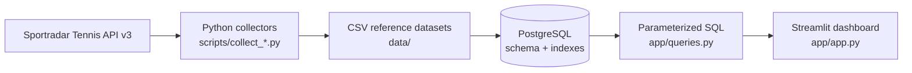
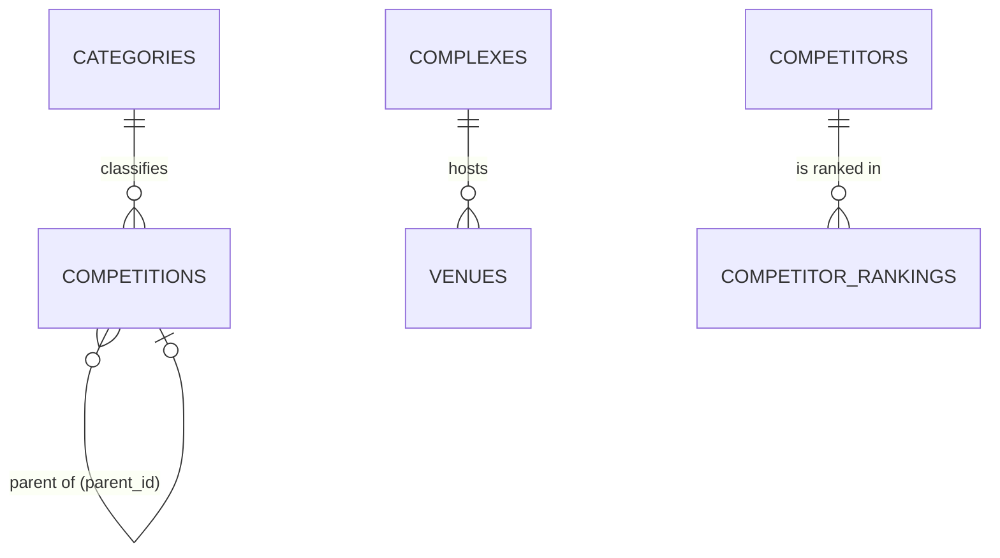

# 🎾 Tennis Game Analytics

**Sportradar Tennis API → Python collectors → PostgreSQL → SQL analytics → Streamlit dashboard**

[](https://www.python.org/)
[](https://www.postgresql.org/)
[](https://streamlit.io/)
[](https://supabase.com/)

> **Live dashboard:** https://game-analytics-tennis-sportradar-8cgwry9d9rb8cn4wz243qj.streamlit.app/
>
> Free Streamlit apps go to sleep when idle. The first visit may take a short while to wake the app.

---

## Table of contents

1. [Overview](#overview)
2. [Dashboard tour](#dashboard-tour)
3. [Architecture](#architecture)
4. [Project structure](#project-structure)
5. [Data model](#data-model)
6. [Getting started](#getting-started)
7. [Configuration](#configuration)
8. [API collectors](#api-collectors)
9. [SQL reference](#sql-reference)
10. [Deploy to Streamlit Community Cloud](#deploy-to-streamlit-community-cloud)
11. [Testing and validation](#testing-and-validation)
12. [Troubleshooting](#troubleshooting)
13. [Data-quality decisions](#data-quality-decisions)
14. [Known limitations](#known-limitations)
15. [Sources](#sources)

---

## Overview

This project is a data analytics pipeline built on the **Sportradar Tennis API**. It:

- collects **competitions**, **complexes and venues**, and **doubles competitor rankings** from the API,
- flattens the nested JSON into normalized CSV datasets,
- loads them into a **relational PostgreSQL** database with primary keys, foreign keys and indexes,
- answers analytical questions with **27 parameterized SQL queries**, and
- presents the results in an interactive **Streamlit** dashboard.

It was built as a portfolio project to demonstrate API integration, error handling, data validation, relational design, SQL analysis and dashboard development.

---

## Dashboard tour

| Page | What it shows | Main SQL |
|---|---|---|
| **Overview** | Total competitors, countries represented, highest points | 6.1 |
| **Competitors** | *Search* by name, *Filter* by rank range, country and minimum points, and *Details* for one competitor | 6.3, 6.4 |
| **Countries** | Competitor count and average points per country, as a table and bar chart | 6.2 |
| **Leaderboards** | Top 10 by points and the biggest rank movers | 6.5, 6.6 |
| **Competitions** | Competition hierarchy (tournament → sub-events), filterable by type and category | 3.x |
| **Venues** | Venues filtered by complex and country | 4.x |

All result tables are paginated, so the app never loads a whole table into memory.

---

## Architecture



| Layer | Technology | Responsibility |
|---|---|---|
| Collection | Python, `requests` | Call the API, retry on rate limits, flatten JSON |
| Storage | PostgreSQL 16+ (MySQL 8 scripts also supplied) | Normalized relational tables, constraints, indexes |
| Analysis | SQL | 27 queries, including the dashboard queries |
| Presentation | Streamlit, pandas | Interactive pages, filters, charts |
| Hosting | Streamlit Community Cloud + Supabase | Public app and hosted database |

---

## Project structure

```text
game-analytics-tennis-sportradar/
├── app/                     Streamlit dashboard
│   ├── app.py               Pages and interaction
│   ├── db.py                Read-only database connection and query helpers
│   └── queries.py           Parameterized SQL used by the app
├── scripts/                 API collection and validation
│   ├── api_client.py        HTTP client with retries and backoff
│   ├── collect_competitions.py
│   ├── collect_complexes.py
│   ├── collect_rankings.py
│   ├── validate_data.py     CSV checks (columns, keys, foreign keys)
│   └── config.py            Settings from environment variables
├── sql/                     Schema, queries and loaders
│   ├── tennis_queries_postgres.sql
│   ├── tennis_queries_mysql.sql
│   ├── load_postgres.sql
│   └── load_mysql.sql
├── data/                    Reference CSV datasets (six tables)
├── tests/                   Automated validation tests
├── .streamlit/
│   └── secrets.toml.example Template for Streamlit Cloud secrets
├── report.md                Final project report
├── CHANGES.md               Data and code fixes, with rationale
└── requirements.txt
```

---

## Data model



| Table | Primary key | Foreign key | Rows | Notes |
|---|---|---|---|---|
| `categories` | `category_id` | — | 9 | ATP, WTA, ITF Men, ITF Women, Challenger, WTA 125, Grand Slam, Davis Cup, United Cup |
| `competitions` | `competition_id` | `category_id` → categories | 33 | `parent_id` is NULL for tournaments. Sub-events point to their tournament. |
| `complexes` | `complex_id` | — | 8 | Venue groupings (for example, Nacional, Accor Arena) |
| `venues` | `venue_id` | `complex_id` → complexes | 14 | Includes ISO country code and IANA timezone |
| `competitors` | `competitor_id` | — | 30 | Doubles players with country and abbreviation |
| `competitor_rankings` | `rank_id` (auto) | `competitor_id` → competitors | 30 | Rank, movement, points and competitions played |

`competitions.parent_id` deliberately has **no foreign key**. The API can return a parent that is not part of the same response, and enforcing the key would break bulk inserts. Indexes cover every foreign key and every column used in `WHERE`, `GROUP BY` or `ORDER BY`.

---

## Getting started

### Prerequisites

- Python **3.11+**
- PostgreSQL **16+** (local install, Docker, or a hosted provider such as Supabase or Neon)
- A Sportradar Tennis API key (only needed to re-collect data; the CSVs are included)

### 1. Clone and install

```bash
git clone https://github.com/SANSKAR500/game-analytics-tennis-sportradar.git
cd game-analytics-tennis-sportradar
python -m venv .venv
source .venv/bin/activate          # Windows: .venv\Scripts\activate
pip install -r requirements.txt
```

### 2. Configure

```bash
cp .env.example .env
```

Edit `.env` with your database settings (and your Sportradar key if you plan to collect data). See [Configuration](#configuration).

### 3. Create the database and load the data

```bash
createdb -U postgres tennis_db
psql -U postgres -d tennis_db -f sql/load_postgres.sql
```

The loader creates the tables, indexes and all rows from `data/`. It can be re-run safely because it drops and recreates the tables first.

Optional, MySQL 8:

```bash
mysql --local-infile=1 -u root -p < sql/load_mysql.sql
```

### 4. Check the data

```bash
python scripts/validate_data.py
pytest -q
```

### 5. Run the dashboard

```bash
streamlit run app/app.py
```

Open the URL Streamlit prints (usually http://localhost:8501).

---

## Configuration

Settings are read from environment variables or a local `.env` file. On Streamlit Community Cloud, the same keys are read from the app's **Secrets** box.

| Variable | Required | Default | Purpose |
|---|---|---|---|
| `DB_HOST` | Yes | `localhost` | Database host |
| `DB_PORT` | Yes | `5432` | Database port |
| `DB_NAME` | Yes | `tennis_db` | Database name (`postgres` on Supabase) |
| `DB_USER` | Yes | `postgres` | Database user (`postgres.<project-ref>` on Supabase pooler) |
| `DB_PASSWORD` | Yes | — | Database password |
| `DB_SSLMODE` | No | `prefer` | Use `require` for hosted databases |
| `SPORTRADAR_API_KEY` | Collectors only | — | Sportradar API key. Never commit it. |
| `SPORTRADAR_ACCESS_LEVEL` | No | `trial` | API access level |
| `SPORTRADAR_LANGUAGE` | No | `en` | API response language |
| `SPORTRADAR_TIMEOUT` | No | `30` | Request timeout in seconds |
| `SPORTRADAR_MAX_RETRIES` | No | `4` | Retries for rate-limit and server errors |

---

## API collectors

The collectors call the Tennis API v3 and write the CSVs in `data/`.

| Script | Endpoint | Output |
|---|---|---|
| `scripts/collect_competitions.py` | `GET /tennis/{access}/v3/{lang}/competitions.json` | `categories.csv`, `competitions.csv` |
| `scripts/collect_complexes.py` | `GET /tennis/{access}/v3/{lang}/complexes.json` | `complexes.csv`, `venues.csv` |
| `scripts/collect_rankings.py` | `GET /tennis/{access}/v3/{lang}/double_competitors_rankings.json` | `competitors.csv`, `competitor_rankings.csv` |

Run them from the project root:

```bash
python scripts/collect_competitions.py --dry-run   # prints counts, writes nothing
python scripts/collect_competitions.py             # writes the CSVs
```

**How the collectors behave**

- The API key is sent in the `x-api-key` header, never in the URL.
- Rate-limit responses (HTTP 429) and server errors are retried with exponential backoff.
- Client errors (for example, a wrong key) stop the run immediately with a clear message.
- If the response does not contain the expected top-level key, the collector stops with an error that lists the keys it did receive. It never writes an empty file silently.
- Nested JSON is flattened into the table layout above, and the output columns match the reference files in `data/`.

---

## SQL reference

All queries live in `sql/tennis_queries_postgres.sql` (with a MySQL 8 equivalent in `sql/tennis_queries_mysql.sql`).

**Competitions (3.1–3.7)**

| # | Query |
|---|---|
| 3.1 | All competitions with their category name |
| 3.2 | Number of competitions per category |
| 3.3 | All competitions of type `doubles` |
| 3.4 | Competitions in a specific category (for example, ITF Men) |
| 3.5 | Parent tournaments and their sub-events |
| 3.6 | Distribution of competition types by category |
| 3.7 | Top-level competitions (no parent) |

**Venues and complexes (4.1–4.7)**

| # | Query |
|---|---|
| 4.1 | All venues with their complex name |
| 4.2 | Number of venues per complex |
| 4.3 | Venues in a specific country (for example, Chile) |
| 4.4 | All venues and their timezones |
| 4.5 | Complexes with more than one venue |
| 4.6 | Venues grouped by country |
| 4.7 | Venues for a specific complex (for example, Nacional) |

**Competitor rankings (5.1–5.6)**

| # | Query |
|---|---|
| 5.1 | All competitors with rank and points |
| 5.2 | Competitors ranked in the top 5 |
| 5.3 | Competitors with no rank movement |
| 5.4 | Total points for a specific country (for example, Croatia) |
| 5.5 | Number of competitors per country |
| 5.6 | Competitors with the highest points in the latest snapshot (ties included) |

**Dashboard queries (6.1–6.7)**

| # | Query |
|---|---|
| 6.1 | Homepage summary: total competitors, countries, highest points |
| 6.2 | Country analysis: competitor count and average points |
| 6.3 | Search competitors by name |
| 6.4 | Filter by rank range, country and points threshold |
| 6.5 | Leaderboard: top 10 by points |
| 6.6 | Biggest rank movers, up and down |
| 6.7 | Countries with no ranked competitors (data-quality check) |

The app's own versions of these queries are in `app/queries.py`. They use bound parameters (`%(name)s`), so user input is never concatenated into SQL.

---

## Deploy to Streamlit Community Cloud

Streamlit Community Cloud cannot reach a database on your computer, so the database must be hosted. This project uses **Supabase** (free tier).

**1. Create a hosted database**

1. Create a Supabase project and note the database password.
2. Open **Connect → Session pooler**. Use the pooler, not the direct connection, because Streamlit Cloud needs IPv4.
3. Load the schema and data from your computer:

   ```bash
   psql "host=<pooler-host> port=5432 dbname=postgres user=postgres.<project-ref> password=<password> sslmode=require" -f sql/load_postgres.sql
   ```

**2. Deploy the app**

1. Push this repository to GitHub. Do not push `.env` or any secrets file.
2. On [share.streamlit.io](https://share.streamlit.io), create a new app from the repository.
3. Set the **main file path** to `app/app.py`.
4. In **App settings → Secrets**, paste the values from `.streamlit/secrets.toml.example`, using your real password:

   ```toml
   DB_HOST = "aws-0-ap-southeast-1.pooler.supabase.com"
   DB_PORT = "5432"
   DB_NAME = "postgres"
   DB_USER = "postgres.<project-ref>"
   DB_PASSWORD = "your-database-password"
   DB_SSLMODE = "require"
   ```

5. Save, then reboot the app. Streamlit reads secrets only when the app starts.

The app reads Streamlit secrets first and falls back to environment variables, so the same code runs locally and in the cloud.

---

## Testing and validation

| Check | Command | What it covers |
|---|---|---|
| CSV validation | `python scripts/validate_data.py` | Column order, required values, duplicate primary keys, foreign-key relationships |
| Unit tests | `pytest -q` | Validation rules |
| Database load | `psql -f sql/load_postgres.sql` | Schema, constraints and data load in one run |
| Query check | Run the query file against the loaded database | All 27 queries execute without errors |

The validator checks these foreign-key relationships:

- competition → category
- venue → complex
- ranking → competitor

---

## Troubleshooting

| Symptom | Likely cause | Fix |
|---|---|---|
| `connection refused` to `localhost:5432` on Streamlit Cloud | Secrets not saved, or app not rebooted | Add the secrets in App settings, save, reboot. The app falls back to `localhost` when no host is set. |
| `password authentication failed` | Wrong password | Reset the database password in the database settings, then update `DB_PASSWORD` |
| Connection hangs or fails only on Streamlit Cloud | Direct database host used | Use the **Session pooler** host and the `postgres.<project-ref>` user |
| Database unreachable after a few days | Free Supabase projects pause when idle | Restore the project in the Supabase dashboard |
| Tables are missing | Loader not run | Run `sql/load_postgres.sql` against the database |
| `parent_id` filter returns nothing | Blank values loaded as text, not NULL | Use the provided loaders, which convert blank values to NULL |
| Collector stops with "root key ... missing" | API response shape differs from the expected format | Check the keys listed in the error and update the collector |

---

## Data-quality decisions

These corrections are documented in `CHANGES.md`.

| Issue | Decision |
|---|---|
| Tournaments were typed `mixed`, which describes a format, not a tournament | Typed as `tournament` |
| Mixed doubles events were typed `mixed`, so the doubles filter missed them | Typed as `doubles` with gender `mixed` |
| United Cup was filed under Grand Slam | Given its own United Cup category |
| Blank `parent_id` values | Loaded as NULL, so top-level filters work |
| Rankings have no week or year | The ranking query is labelled as the latest snapshot |

---

## Known limitations

- **No competition level.** The schema has no level column, so category is used as the stand-in for level.
- **No competitor-to-competition link.** The schema cannot say which players entered singles or doubles events, so participation queries are not possible.
- **No ranking history.** Rankings are a single snapshot. Week and year metadata from the API is not stored.
- **Doubles only.** The rankings are doubles rankings. They should not be presented as ATP singles rankings.
- **Static data in the hosted app.** The dashboard shows the loaded snapshot. It does not refresh automatically from the API.

---

## Sources

- Sportradar Tennis API documentation
  - [Competitions](https://developer.sportradar.com/tennis/reference/competitions)
  - [Complexes](https://developer.sportradar.com/tennis/reference/complexes)
  - [Doubles competitor rankings](https://developer.sportradar.com/tennis/reference/doubles-competitor-rankings)
  - [API basics](https://developer.sportradar.com/tennis/docs/tennis-ig-api-basics)
- [Streamlit documentation](https://docs.streamlit.io/)
- [Supabase documentation](https://supabase.com/docs)

---

<p align="center">Built by <strong>Sanskar</strong> · Game Analytics: Unlocking Tennis Data with Sportradar API</p>
